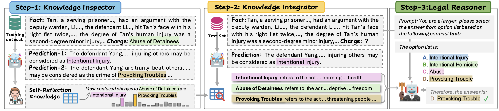
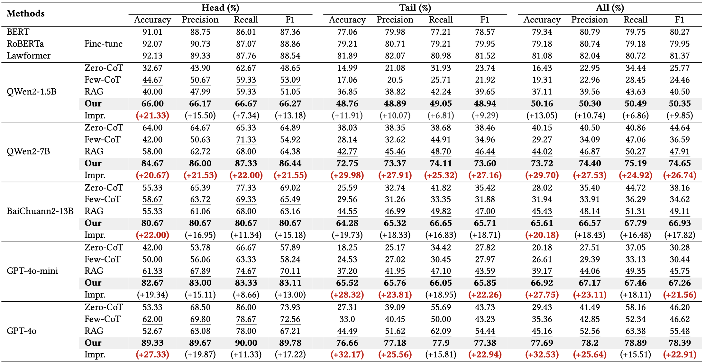
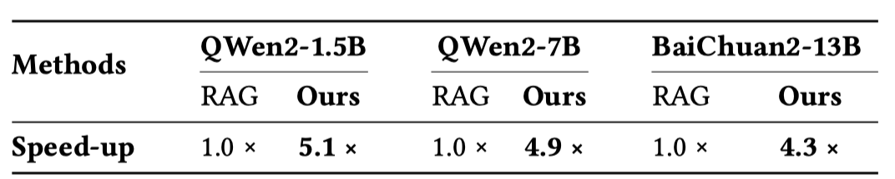

# KnowTail
Legal Knowledge Retrieval for Long-Tailed Charge Prediction

# Introduction
Recently, LLM shows promising ability of charge reasoning. However, Solvers such as RAG suffer from the long-tail distribution. To tackle this issue, we propose a new framework (denoted as KnowTail), which establish a new SOTA on long-tailed charge prediction task. Moreover, our framework achieve the 4.7x speed up compared to the previous retrieval augment generation (RAG) based methods.

# KnowTail

The figure shows the overall architecture of KwowTail including the Knowledge Inspector module, Knowledge Integrator module, and the Legal Reasoner module. In particular, we first use the Knowledge Inspector to get the self-reflection knowledge for the given LLM. Then, for the given legal case, the Knowledge Integrator is used to retrieve the knowledge the LLM requires. Finally, Legal Reasoner elicits the LLMs to conduct legal reasoning by providing the retrieved knowledge.

# Results

## Overall performance on CAIL

The table shows the overall performance on dataset CAIL, where the second-best score is underlined and the best is marked with bold. the Impr. denotes the improvement of our method over the previous SoTA, and the improvements over 20% are marked in red.

## Speed Up

